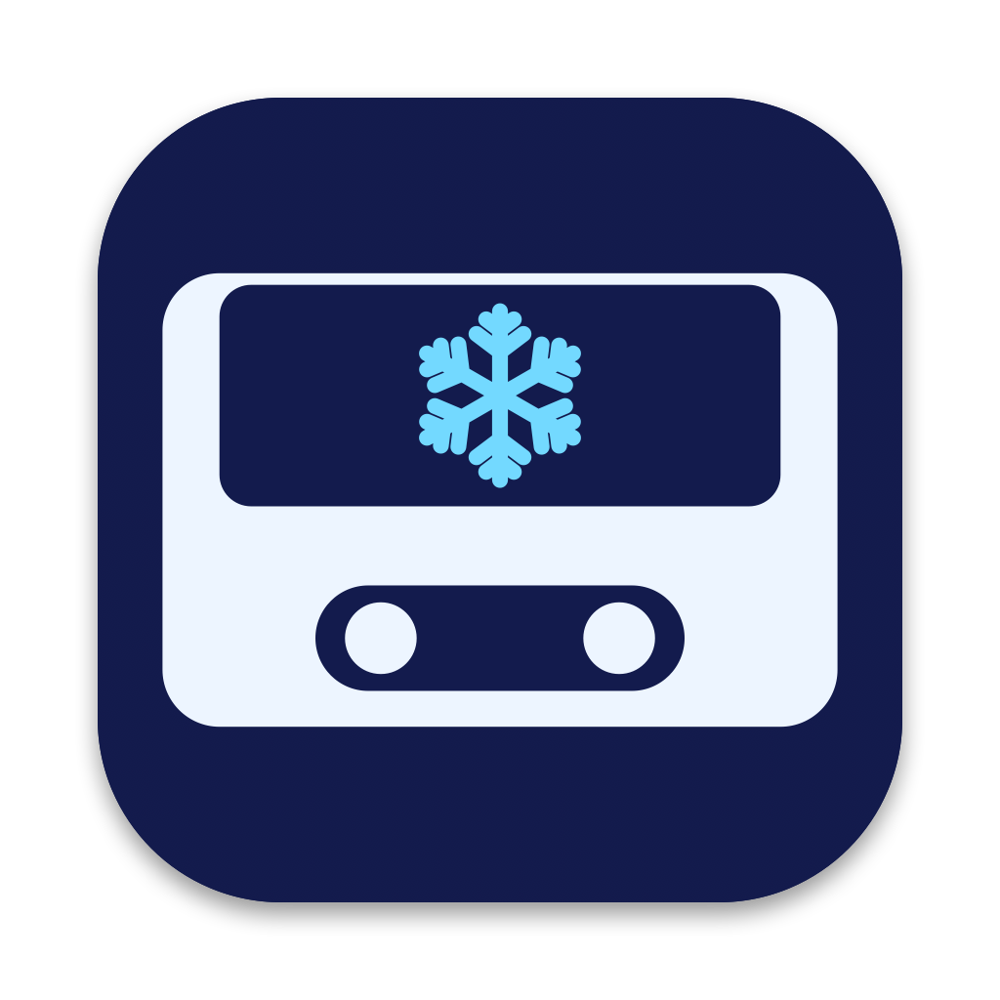

<p align="center">
  
</p>

<h1 align="center">Snowdrop</h1>
<h2 align="center">A minimalistic custom YT Music client for macOS</h2>

>[!CAUTION]
>This is unofficial YT Music client! Google don't support that.

>[!NOTE]
>This project is forked from sozercan/kaset

<h3 align="center"><b>⭐️ Features</b></h3>

- **💽 Floating Player**: Floating overlay that is showing 'Now Playing' and you can control songs
- **💻 Recommendations**: Recommendations are organized like in YT Music original client
- **🔧 Other**: Almost all features from Kaset: https://github.com/sozercan/kaset

<h3 align="center"><b>📟 Requirements</b></h3>

- **macOS Version**: macOS 15.4 or later (Apple Intelligence features need macOS 26)                      
- **Other**: Google Account (signed-in playback)

<h3 align="center"><b>🔧 Installation</b></h3>

- Download latest release from Releases
- Open the `.dmg` file
- Drag Snowdrop to Applications
- Gatekeeper will block the app from launching because it's not signed, bypass it by clicking _Right Click -> Open_ or _System Settings -> Accessbility -> Open Anyway_

<h3 align="center"><b>✏️ Building</b></h3>

```zsh
git clone https://github.com/varla-am/snowdrop
cd snowdrop
xcodebuild -project Snowdrop.xcodeproj -scheme Snowdrop -configuration Release build
```

<h2 align="center"><b>⚙️ Credits</b></h2>

**Snowdrop** is a fork of [Kaset](https://github.com/sozercan/kaset) by sozercan, licensed under the MIT license. See [LICENSE](LICENSE).
